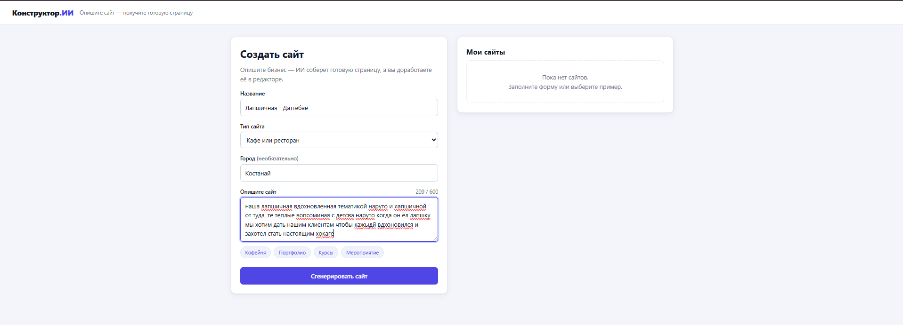
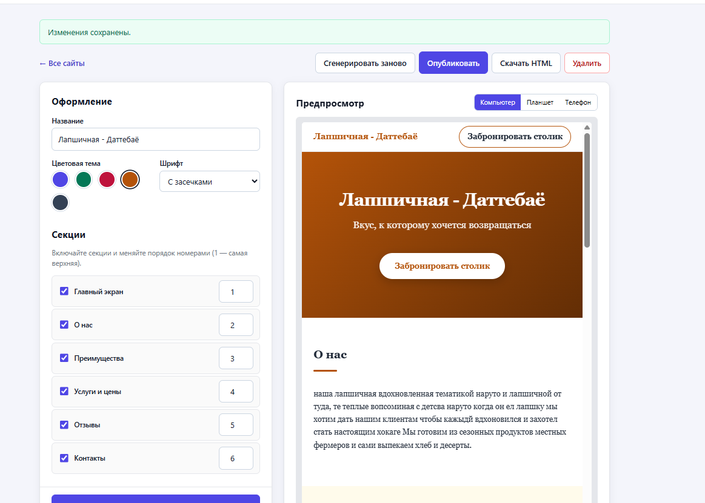
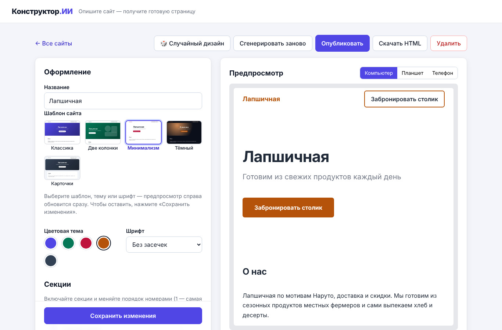
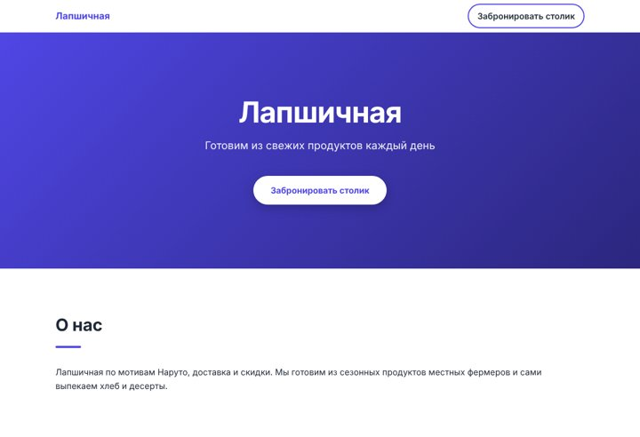
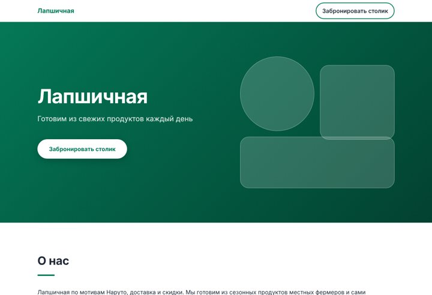
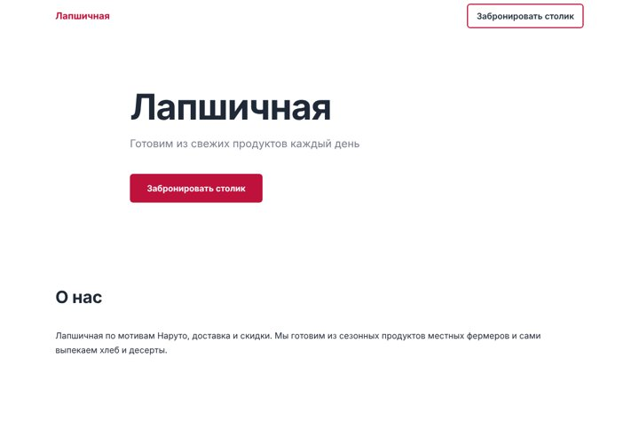
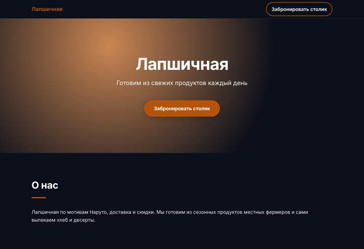
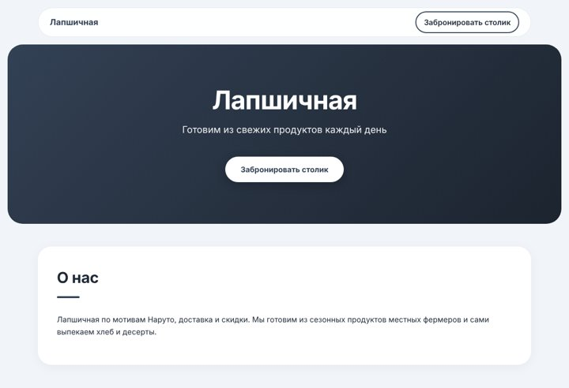

# ИИ-конструктор веб-сайтов

Учебный проект ПМ02 на **Laravel 13**. Вы описываете сайт словами — конструктор собирает готовую одностраничную страницу. Её можно доработать в редакторе, опубликовать по ссылке или скачать одним HTML-файлом.



## Содержание

- [Быстрый старт](#быстрый-старт)
- [Возможности](#возможности)
- [Как это выглядит](#как-это-выглядит)
- [Шаблоны](#шаблоны)
- [Как работает генерация](#как-работает-генерация)
- [Подключение нейросети](#подключение-нейросети)
- [Устройство проекта](#устройство-проекта)
- [Маршруты](#маршруты)
- [Тесты](#тесты)
- [Если что-то не работает](#если-что-то-не-работает)

## Быстрый старт

Нужен только **PHP 8.3 или новее**. Composer и Node.js не требуются: папка `vendor` уже лежит в репозитории.

```powershell
git clone https://github.com/MarFaus/ai_constructor_websites
cd ai_constructor_websites
.\start.bat
```

Либо скачайте проект и дважды щёлкните **`start.bat`**. При первом запуске он:

1. проверит версию PHP и нужные расширения;
2. создаст `.env` и ключ приложения;
3. создаст базу SQLite и выполнит миграции;
4. откроет браузер на <http://127.0.0.1:8000>.

Остановить сервер: закрыть окно или нажать `Ctrl+C`.

<details>
<summary>Запуск вручную (Linux, macOS или без start.bat)</summary>

```bash
cp .env.example .env
php artisan key:generate
touch database/database.sqlite
php artisan migrate
php artisan serve
```

Если папки `vendor` нет, сначала выполните `composer install`.
</details>

## Возможности

| Возможность | Как работает |
|---|---|
| Генерация по описанию | Название, тип сайта, город и свободное описание. Есть готовые примеры одним щелчком |
| 6 типов сайта | Кафе, магазин, портфолио, курсы, услуги, мероприятие |
| 5 шаблонов | Классика, две колонки, минимализм, тёмный, карточки |
| Умный подбор | Конструктор ищет в описании слова («доставка», «скидки», «детский», «онлайн») и добавляет подходящие преимущества |
| Выбор шаблона | Плитки с картинками в редакторе, предпросмотр обновляется сразу |
| Рандомайзер | Шаблон, цвет и шрифт подбираются автоматически, кнопка «Случайный дизайн» меняет оформление, «Сгенерировать заново» меняет тексты и дизайн |
| Редактор | Названия, тексты, цены и контакты; 5 цветовых тем, 3 шрифта |
| Секции | Включение и отключение секций, порядок задаётся номерами |
| Предпросмотр | Рядом с формой, переключение «компьютер / планшет / телефон» |
| Публикация | Публичная ссылка `/s/название`, можно снять с публикации |
| Скачивание | Готовый одиночный `.html` без внешних зависимостей |

## Как это выглядит

**Редактор с предпросмотром**



## Шаблоны

### Как сменить шаблон

1. Создайте сайт. В форме можно сразу выбрать шаблон или оставить «Подобрать автоматически».
2. В редакторе (страница сайта, откроется после создания или по кнопке «Открыть» в списке) слева вверху находятся **плитки шаблонов**. Щёлкните по нужной.
3. Предпросмотр справа обновится сразу. Так же работают выбор цвета и шрифта.
4. Понравилось — нажмите **«Сохранить изменения»** внизу слева. Без сохранения вариант не запоминается.

Кнопки над редактором: **«🎲 Случайный дизайн»** подбирает шаблон, цвет и шрифт случайно, **«Сгенерировать заново»** меняет ещё и тексты.



### Все шаблоны

| Классика | Две колонки |
|---|---|
|  |  |

| Минимализм | Тёмный |
|---|---|
|  |  |

| Карточки |
|---|
|  |

Один и тот же текст в любом шаблоне можно перекрасить в одну из пяти цветовых тем: индиго, изумруд, роза, янтарь, графит.

## Как работает генерация

```text
описание ──► анализ ключевых слов ──► преимущества + подсказка темы
   │
   ├─ без ключа ──► шаблоны текстов по типу сайта (SiteGenerator)
   └─ с ключом  ──► запрос к нейросети ──► при ошибке: те же шаблоны
                                  │
выбор дизайна (шаблон, тема, шрифт) ◄─ по названию и описанию, меняется с каждой генерацией
```

Без ключа работает офлайн-генератор: тексты берутся из заготовок по типу сайта и дополняются карточками по ключевым словам. Результат детерминирован: одинаковые данные дают тот же сайт, а «Сгенерировать заново» выдаёт другой вариант.

## Подключение нейросети

Необязательно. Впишите в `.env` ключ (любой OpenAI-совместимый API):

```env
AI_API_KEY=ваш_ключ
AI_BASE_URL=https://api.openai.com/v1
AI_MODEL=gpt-4o-mini
```

После перезапуска тексты генерирует модель. При ошибке сети или неверном ответе автоматически включается офлайн-генератор, так что сайт создастся в любом случае.

## Устройство проекта

```text
app/
├── Models/Site.php                       модель сайта (JSON-поля content и sections)
├── Services/SiteGenerator.php            генератор: ключевые слова, шаблоны текстов, подбор дизайна, запрос к ИИ
└── Http/
    ├── Controllers/SiteController.php    создание, редактор, публикация, скачивание
    └── Requests/SiteRequest.php          проверка форм
config/ai.php                             настройки нейросети
database/migrations/                      таблица sites и поле template
resources/views/
├── layouts/app.blade.php                 общий каркас конструктора
├── sites/index.blade.php                 список и форма создания
├── sites/edit.blade.php                  редактор с предпросмотром
└── site.blade.php                        шаблон готового сайта (5 вариантов)
tests/Feature/SiteTest.php                19 функциональных тестов
start.bat                                 запуск на Windows
```

База данных — SQLite (`database/database.sqlite`), отдельный сервер не нужен.

## Маршруты

| Метод | URI | Назначение |
|---|---|---|
| GET | `/` | Список сайтов и форма создания |
| POST | `/sites` | Создать и сгенерировать |
| GET | `/sites/{id}/edit` | Редактор |
| PUT | `/sites/{id}` | Сохранить изменения |
| POST | `/sites/{id}/regenerate` | Сгенерировать заново |
| POST | `/sites/{id}/randomize` | Случайный дизайн |
| POST | `/sites/{id}/publish` | Опубликовать / снять с публикации |
| GET | `/sites/{id}/preview` | Предпросмотр |
| GET | `/sites/{id}/download` | Скачать HTML |
| GET | `/s/{slug}` | Публичная страница |
| DELETE | `/sites/{id}` | Удалить |

## Тесты

```bash
php artisan test
```

Или дважды щёлкните `test.bat`. Проверяются создание и валидация, детерминированность генератора, подбор по ключевым словам, все пять шаблонов, случайный дизайн, порядок и отключение секций, публикация, скачивание, экранирование HTML, ответ и отказ нейросети.

## Если что-то не работает

| Симптом | Что делать |
|---|---|
| «PHP не найден» | Установите PHP 8.3+ и добавьте в PATH либо распакуйте его в папку `php\` рядом с `start.bat` |
| «Не включены расширения» | `start.bat` покажет, какой `php.ini` используется. Откройте его и уберите `;` перед `extension=pdo_sqlite`, `sqlite3`, `mbstring`, `openssl`, `fileinfo` |
| Порт 8000 занят | Закройте другую программу или запустите вручную `php artisan serve --port=8080` |
| Изменили `.env`, а ничего не поменялось | Перезапустите `start.bat` |
